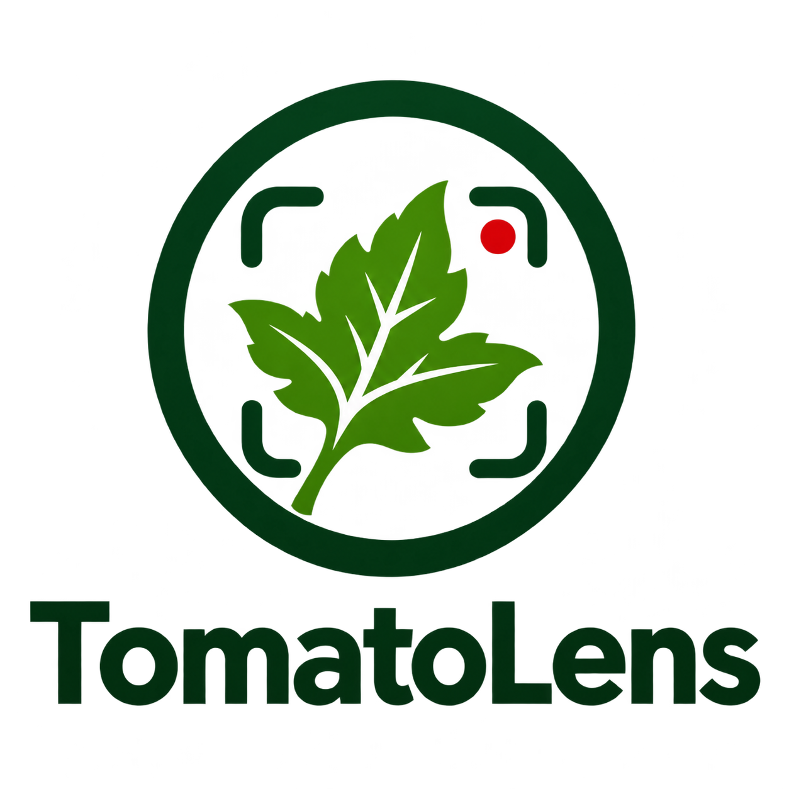
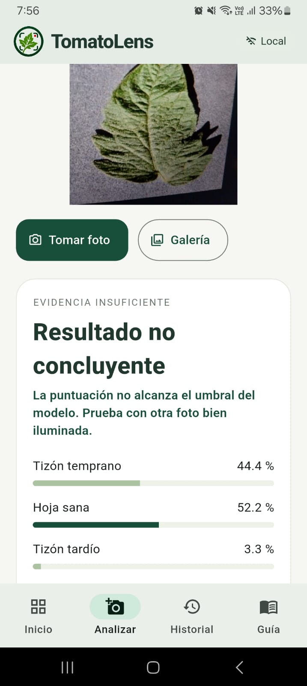
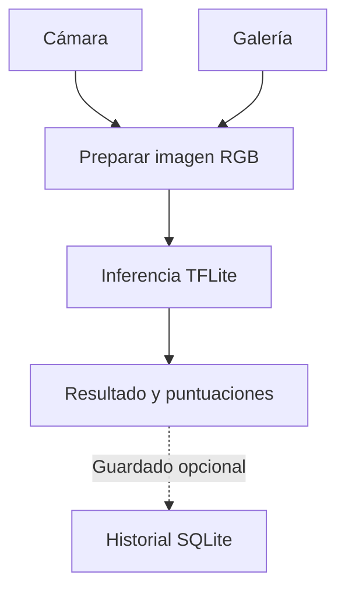
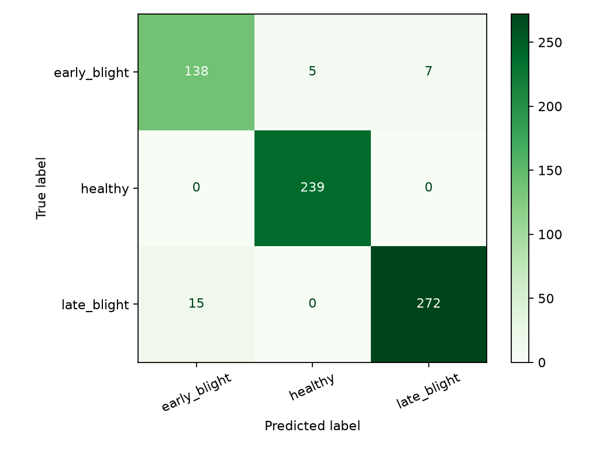

<p align="center">
  
</p>

# TomatoLens

**App Android que analiza fotografías de hojas de tomate sin conexión.** Usa un modelo de aprendizaje profundo en el celular para distinguir entre **hoja sana**, **tizón temprano** y **tizón tardío**. Es un proyecto académico del curso de Deep Learning.

[Capturas](#capturas-de-la-app) · [Cómo probarlo](#cómo-probarlo) · [Modelo y resultados](#modelo-y-resultados) · [CI/CD](#pruebas-y-cicd) · [Equipo](#equipo-y-créditos)

## ¿Qué es TomatoLens?

TomatoLens permite hacer una revisión orientativa de una hoja de tomate a partir de una fotografía. El análisis se ejecuta en el dispositivo y el historial se guarda localmente. Si el modelo distribuido tiene una política de decisión configurada y la puntuación no alcanza el umbral, la app puede mostrar **Resultado no concluyente**.

## Cómo se usa

1. Abre **Analizar** y toma una foto o elige una desde la **Galería**.
2. Revisa la vista previa y confirma el análisis. Procura encuadrar una sola hoja de tomate, bien iluminada y enfocada.
3. Consulta el resultado y las puntuaciones de las tres clases. Si el resultado es no concluyente, prueba con otra foto.
4. Guarda el análisis si quieres consultarlo después en **Historial**. En **Guía** puedes configurar si se conservan las fotos y si se guardan los resultados automáticamente.

## Capturas de la app

<p align="center">
  
  <br>
  <strong>Resultado de un análisis en Android</strong><br>
  La app muestra las puntuaciones y avisa cuando la imagen no da evidencia suficiente para elegir una clase.
</p>

<!--
Para ampliar la galería, guarda las capturas en docs/images/app/ y añade los bloques HTML cuando existan los archivos:
<p align="center">
  
  
</p>
<p align="center">
  
  
</p>
-->

## Cómo probarlo

### Instalar el APK en Android

En [GitHub Actions](https://github.com/JesusLoza1506/TomatoLens/actions), abre una ejecución exitosa de **Android CD** y descarga `tomatolens-vX.Y.Z-release` desde **Artifacts**, si está disponible. Extrae el ZIP y abre el APK en el celular. La compilación está destinada a pruebas internas y el artefacto tiene un periodo de retención. Si no hay un APK disponible, puedes compilarlo desde el código.

### Ejecutar desde el código

Necesitas **Flutter 3.32.8**, **JDK 17** y el SDK de Android. Conecta un celular con depuración USB o inicia un emulador.

```powershell
git clone https://github.com/JesusLoza1506/TomatoLens.git
Set-Location TomatoLens/frontend
flutter pub get --enforce-lockfile
flutter devices
flutter run
```

Si aparecen varios dispositivos, usa `flutter run -d ID_DEL_DISPOSITIVO`. Para generar un APK local, ejecuta `flutter build apk --release` desde `frontend/`; el archivo queda en `frontend/build/app/outputs/flutter-apk/app-release.apk`, visto desde la raíz. Consulta la [guía de la app Flutter](frontend/README.md) para más detalles.

## Cómo funciona



Flutter gestiona la captura, la vista previa y las pantallas. La imagen se prepara en RGB a **224 × 224** píxeles y se envía al modelo **TFLite** incluido en la app. El resultado se puede guardar en SQLite, con o sin la fotografía, según la preferencia del usuario.

## Modelo y resultados

### Datos y entrenamiento

Se usaron **4 500 imágenes de tres clases de [PlantVillage](https://github.com/spMohanty/PlantVillage-Dataset)**. El conjunto se dividió en **3 148** imágenes para entrenamiento, **676** para validación y **676** para prueba, manteniendo juntas las imágenes relacionadas al formar las particiones.

El modelo usa **MobileNetV2** con pesos iniciales de ImageNet. Se entrenó primero la capa de clasificación y luego se ajustó una parte de la red. El punto de control se eligió usando la pérdida de validación. El entrenamiento se realizó con **TensorFlow 2.15.1** y el flujo de exportación convierte el modelo a TFLite para Android.

### Evaluación en PlantVillage

El modelo de TensorFlow obtuvo **96,01 % de exactitud** y **95,39 % de F1 macro** en las **676 imágenes de prueba**. La siguiente tabla muestra el resultado por clase antes de aplicar el umbral de abstención.

| Clase | Imágenes de prueba | Precisión | Sensibilidad | F1 |
|---|---:|---:|---:|---:|
| Hoja sana | 239 | 97,95 % | 100,00 % | 98,96 % |
| Tizón temprano | 150 | 90,20 % | 92,00 % | 91,09 % |
| Tizón tardío | 287 | 97,49 % | 94,77 % | 96,11 % |

<p align="center">
  
</p>

Con el umbral ajustado en validación, el modelo emitió una clase en **656 de 676** imágenes de prueba (**97,04 % de cobertura**) y acertó en **639 de las 656 aceptadas** (**97,41 %**). Los otros 20 casos quedaron sin clasificación. Consulta el [reporte de evaluación](docs/results/evaluation-plantvillage.json) para ver las métricas y las huellas del modelo y de las particiones.

## Estructura del repositorio

| Ruta | Contenido |
|---|---|
| [`frontend/`](frontend/) | App Flutter para Android, modelo TFLite, etiquetas y pruebas. |
| [`ml/`](ml/) | Preparación de datos, entrenamiento, evaluación, exportación y pruebas de ML. |
| [`.github/workflows/`](.github/workflows/) | Integración continua y generación del APK por versión. |
| [`docs/`](docs/) | Capturas de la app y evidencias de evaluación. |

## Pruebas y CI/CD

| Flujo | Qué comprueba o genera |
|---|---|
| **Flutter CI** | Instala las dependencias fijadas, analiza el código, ejecuta las pruebas de Flutter y compila un APK de prueba. |
| **ML CI** | Ejecuta Ruff y pytest, incluida una comprobación de inferencia del TFLite empaquetado. |
| **Android CD** | Para etiquetas de versión `vX.Y.Z`, vuelve a comprobar Flutter y ML sobre el mismo commit. Si pasan, compila el APK de entrega interna y guarda su suma SHA-256. |

Consulta el estado del commit que vas a usar en [GitHub Actions](https://github.com/JesusLoza1506/TomatoLens/actions). En un Samsung también se verificaron la paridad entre Python y Android con nueve fotos de referencia y la integración del historial con SQLite.

## Alcance y mejoras futuras

- El modelo se entrenó para **tres clases de hojas de tomate**. Su resultado es orientativo. Una imagen de otra planta u otra enfermedad puede recibir una clasificación incorrecta, incluso con puntuación alta.
- Las métricas corresponden al conjunto de prueba de **PlantVillage**. La evaluación con fotos de campo, distintas cámaras e iluminación real es el siguiente paso para saber cómo se comporta fuera de ese conjunto.
- Otra mejora es documentar el tiempo de inferencia y el consumo de memoria en distintos celulares.

## Equipo y créditos

Proyecto académico del curso de **Deep Learning**.

- Francis Jean Paul Barrientos Atoccsa
- Jesús Ángel Loza Yataco
- Juan Jesús Magallanes Llanos
- Esteban Ricardo Puma Palomino
- Carlos Eden Reyes Esterripa

**Datos:** [PlantVillage Dataset](https://github.com/spMohanty/PlantVillage-Dataset), referencia del trabajo de Sharada P. Mohanty, David P. Hughes y Marcel Salathé.
